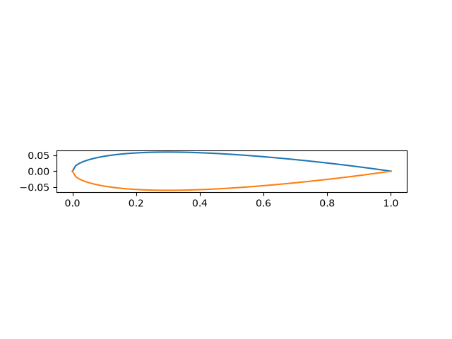

# NACA 4-digit Aerofoil Generation and modelling
python script that generates coordinates of a 4-digit symetrical aerofoil and creates a CSV file to then import to Autodesk fusion as a spline. seaperate script that allows an estimate of wing lift under different angles of attack.

## Why I built it
self directed project aimed at understanding how different aerofoil shapes and angles effect wing lift.

## Features
- input last 2 digits of 4-digit aerofoil section (thickness of aerofoil compared to its length).
- outputs x and y coordinates into CSV
- can be imported into Fusion

## How to run
1. Install Python 3 and numpy: "pip install numpy"
2. Run script: "symetrical_naca4"
3. import the CSV file into fusion as a spline

## Images

